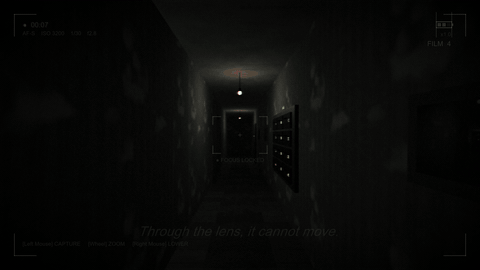
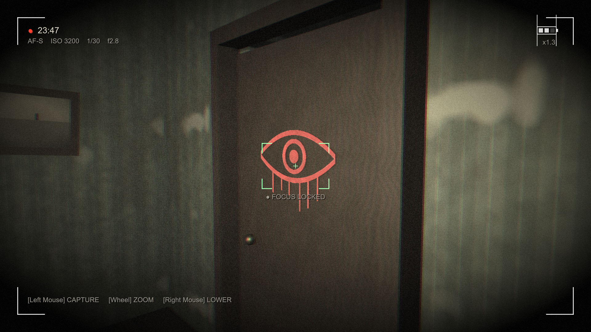
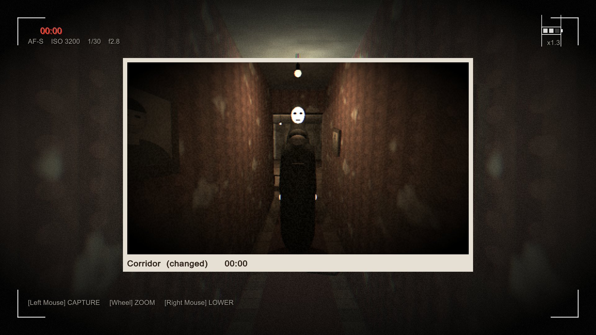
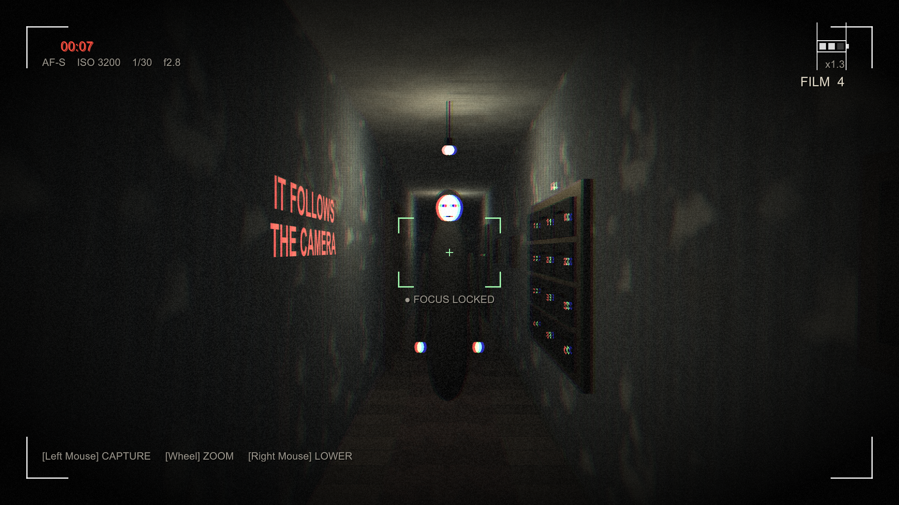
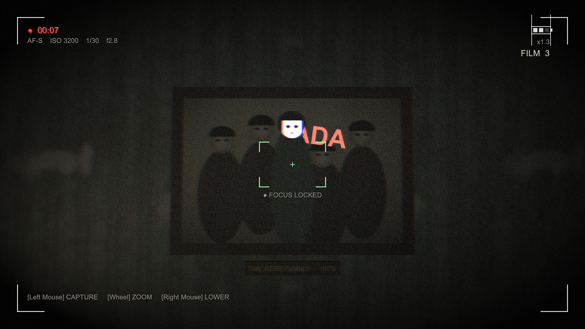

# The Camera Never Lies — *does it?*

A first-person photo-horror game made in Unity. A missing photographer left you a camera and one instruction: **"Do not trust any photograph taken after midnight."**

🏆 **1st Prize — Vibe Lounge, DevFest Chennai 2026**



**▶ Play:** [itch.io](https://agneay.itch.io/the-camera-never-lies) · [Download for Windows (Releases)](../../releases/latest)

## The game

Your camera is your only tool. Raise the viewfinder to reveal what the naked eye can't see: hidden writing, doors that aren't there, people who shouldn't be in the photo. Some photographs change reality. Some change after you take them.

| Chapter | |
|---|---|
| **1 — The Empty Studio** | Explore an abandoned photography studio and solve camera-based puzzles: *The Door That Isn't There* and *The Four Portraits*. Ends in the darkroom. |
| **2 — Someone Was Here** *(harder)* | A ghost hunts you through the building. Through the lens it cannot move — but stare too long and it lunges. A flash photograph drives it back, but film is scarce. If it reaches you, you die. Puzzles: *The Wrong Time*, *The Missing Person*, *Do Not Photograph It*. |

| | |
|---|---|
|  |  |
|  |  |

## Controls

| Input | Action |
|---|---|
| W A S D | Move |
| Shift | Sprint |
| Mouse | Look |
| Right Mouse | Raise / lower camera |
| Left Mouse | Take photograph |
| Mouse Wheel | Zoom (camera raised) |
| E | Interact |
| Tab | Evidence gallery |
| Esc | Pause |
| F11 | Fullscreen |

## How it's built

Everything is generated from code — there are no imported art or audio assets.

- **Level building:** [`Assets/Editor/SceneBuilder.cs`](Assets/Editor/SceneBuilder.cs) (Chapter 1) and [`SceneBuilder.Chapter2.cs`](Assets/Editor/SceneBuilder.Chapter2.cs) build every room, prop, light and puzzle procedurally.
- **Textures:** [`Assets/Editor/ProcTex.cs`](Assets/Editor/ProcTex.cs) — tileable value-noise plaster, wallpaper, wood, portraits and old photographs.
- **Audio:** [`Assets/Scripts/AudioManager.cs`](Assets/Scripts/AudioManager.cs) synthesises every sound at startup (ambience, shutter, footsteps, heartbeat, scream).
- **Dual-reality camera:** a `CameraOnly` / `NormalOnly` layer system swaps what you see when the viewfinder is raised; photographs are real off-screen renders ([`PhotoRenderer.cs`](Assets/Scripts/PhotoRenderer.cs)) graded by a custom post-process shader.
- **Ghost AI:** [`GhostHunter.cs`](Assets/Scripts/Chapter2/GhostHunter.cs) — waypoint-graph pathfinding, freezes while observed, lunges if watched too long, retreats from the flash.
- **Automated playtests:** [`AutoPlaytest.cs`](Assets/Scripts/AutoPlaytest.cs) plays both chapters start to finish and checks every puzzle, death, retry and ending.

## Building from source

Requires **Unity 6 (6000.4.3f1)** with Windows build support.

1. Open the folder in Unity Hub.
2. Menu **Camera Never Lies → Rebuild Scenes**, then **Camera Never Lies → Build Windows Player**.

Or from PowerShell (builds, then runs both automated playtests):

```powershell
./build_and_test.ps1
```

Trailer and stills: run the built game with `-trailer -shots <dir>` (add `-clean` for caption-free stills), then `python Tools/make_showcase.py <dir>/stills Showcase`.

## Credits

Made by [@agneay](https://github.com/agneay) and team for the Vibe Lounge at DevFest Chennai 2026.
